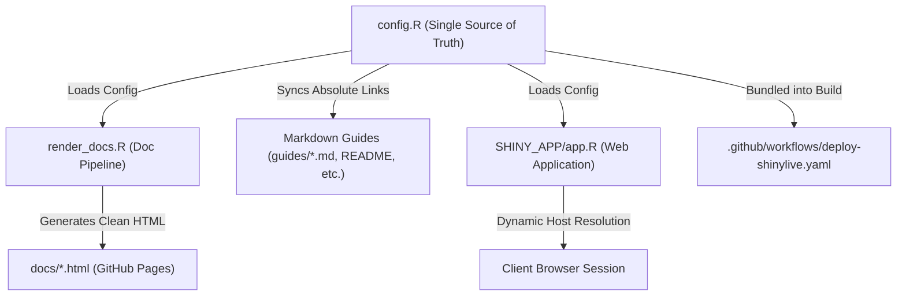

# Prepare to Move a GitHub Repo

A comprehensive guide and architectural pattern for preparing, centralizing, and executing repository transfers between GitHub users or organizations without broken links, deployment failures, or stale documentation.
This also covers the process of changing repo name
where the repo name is used within the repo.

---

## 1. Overview & Challenges

Transferring a GitHub repository to a new personal account or an organization (e.g., from `byandell/MafADiscovery` to an institutional or lab account) introduces several synchronization challenges across code, documentation, and automated deployments:

| Challenge Area | Symptoms if Unprepared | Root Cause |
| :--- | :--- | :--- |
| **GitHub Pages Divergence** | Broken documentation or 404 errors for external visitors. | While GitHub sets up temporary HTTP redirects for repository code (`github.com/old/repo` $\to$ `github.com/new/repo`), **GitHub Pages URLs (`old.github.io/repo`) do not redirect** once pages are rebuilt or namespaces change. |
| **Markdown Source Link Fragility** | Links to guides fail when readers browse source files directly on GitHub. | Relative links to rendered HTML pages (e.g., `[User Guide](user_guide.html)`) produce 404 errors in GitHub's raw markdown viewer because GitHub only serves source files, not the compiled web assets. |
| **Compiled Website Relative Pathing** | Deployed documentation links break when previewed locally or offline. | If Markdown source files use hardcoded absolute URLs (`https://old.github.io/repo/docs/...`), local preview servers and static builds cannot resolve internal pages relatively. |
| **Application Runtime Navigation** | Help/Guide buttons in Shiny/web apps point to obsolete URLs. | Hardcoded URLs in the application UI fail to track the new hosting namespace. |
| **CI/CD Pipeline Lock-In** | Automated deployments fail or publish to incorrect locations. | Workflows with hardcoded organization or user names fail upon transfer. |

To solve these challenges sustainably, this pattern decouples repository identity into a **single source of truth** combined with automated link synchronization and runtime dynamic resolution.

---

## 2. Core Architecture: The Single Source of Truth

Rather than scattering repository URLs and account names across dozens of files, centralize all repository identity attributes into a single configuration file at the repository root: `config.R` (or an equivalent `_config.yml` / `config.json`).



### Reference Implementation (`config.R`)

```r
# config.R
# Central repository configuration — Single Source of Truth
# Update `owner` when transferring the repository to a new user or organization.

GITHUB_CONFIG <- list(
  owner  = "byandell",          # GitHub user or organization
  repo   = "MafADiscovery",     # Repository name
  branch = "main"               # Default production branch
)

# Derived URLs
GITHUB_CONFIG$pages_url <- sprintf("https://%s.github.io/%s", GITHUB_CONFIG$owner, GITHUB_CONFIG$repo)
GITHUB_CONFIG$repo_url  <- sprintf("https://github.com/%s/%s", GITHUB_CONFIG$owner, GITHUB_CONFIG$repo)
GITHUB_CONFIG$docs_url  <- sprintf("%s/docs", GITHUB_CONFIG$pages_url)
GITHUB_CONFIG$blob_url  <- sprintf("%s/blob/%s", GITHUB_CONFIG$repo_url, GITHUB_CONFIG$branch)
```

---

## 3. Dual-Link Strategy: Source Viability vs. Rendered Portability

Documentation must satisfy two conflicting requirements:

1. **Source Readers on GitHub**: Users reading raw Markdown files on `github.com` need absolute URLs (`https://<owner>.github.io/<repo>/docs/user_guide.html`) so clicking a link opens the live compiled documentation.
2. **Web Visitors & Local Testers**: The compiled HTML site on GitHub Pages or local preview must use clean relative links (`user_guide.html`) so links work offline, in local HTTP servers, and under custom domains.

### The Solution: Dynamic Relativization at Build Time

Maintain fully qualified absolute URLs in Markdown source files, but configure the build script (`render_docs.R`) to strip the repository prefix when generating HTML:

```r
# In render_docs.R:
# Automatically relativize internal documentation URLs during HTML rendering
docs_pattern <- sprintf("https://%s\\.github\\.io/%s/docs/", GITHUB_CONFIG$owner, GITHUB_CONFIG$repo)
md_content <- gsub(docs_pattern, "", md_content)
# Catch generic fallback pattern in case of legacy links:
md_content <- gsub("https://[a-zA-Z0-9_-]+\\.github\\.io/[a-zA-Z0-9_-]+/docs/", "", md_content)
```

Result:

* On GitHub source view: `[User Guide](https://byandell.github.io/MafADiscovery/docs/user_guide.html)` $\to$ **Clickable, live documentation**.
* On rendered web page: `<a href="user_guide.html">User Guide</a>` $\to$ **Fast, relative, portable link**.

---

## 4. Automated Markdown Link Synchronization

When the owner changes in `config.R`, an automated synchronization routine scans all Markdown files and rewrites any obsolete GitHub and GitHub Pages URLs.

```r
#' Synchronize absolute GitHub and GitHub Pages links across repository Markdown files
sync_markdown_links <- function(config = GITHUB_CONFIG, dry_run = FALSE) {
  md_files <- c(
    "README.md",
    "DEVELOPER.md",
    list.files("guides", pattern = "\\.md$", full.names = TRUE)
  )
  md_files <- md_files[file.exists(md_files)]
  
  updated_count <- 0
  
  for (f in md_files) {
    content <- readLines(f, encoding = "UTF-8", warn = FALSE)
    orig_text <- paste(content, collapse = "\n")
    new_text <- orig_text
    
    # 1. Update GitHub Pages URLs: https://<any-owner>.github.io/<repo>
    pages_regex <- sprintf("https://[a-zA-Z0-9_-]+\\.github\\.io/%s", config$repo)
    new_text <- gsub(pages_regex, config$pages_url, new_text)
    
    # 2. Update GitHub repository URLs: https://github.com/<any-owner>/<repo>
    repo_regex <- sprintf("https://github\\.com/[a-zA-Z0-9_-]+/%s", config$repo)
    new_text <- gsub(repo_regex, config$repo_url, new_text)
    
    # 3. Update Markdown repository badges/slugs: [<any-owner>/<repo>]
    slug_regex <- sprintf("\\[[a-zA-Z0-9_-]+/%s\\]", config$repo)
    new_text <- gsub(slug_regex, sprintf("[%s/%s]", config$owner, config$repo), new_text)
    
    if (new_text != orig_text) {
      if (!dry_run) {
        writeLines(strsplit(new_text, "\n")[[1]], f, useBytes = TRUE)
      }
      updated_count <- updated_count + 1
      cat(sprintf("  [%s] %s\n", if (dry_run) "Would update" else "Updated", f))
    }
  }
  
  invisible(updated_count)
}
```

By hooking `sync_markdown_links()` directly into the start of `render_docs.R`, running the documentation build automatically guarantees that all Markdown source files stay synchronized with `config.R`.

---

## 5. Web Application Runtime Resilience

Web applications (such as Shiny or Shinylive apps) should avoid hardcoding the deployment URL at runtime.

### Dynamic Client-Side Path Resolution

In `SHINY_APP/app.R`, client-side JavaScript dynamically inspects `window.location` to determine the active host and base path:

```javascript
function resolveDocsUrl(subpath) {
  subpath = subpath || 'user_guide.html';
  if (window.location.pathname.indexOf('/app_') !== -1 || window.location.hostname.includes('github.io')) {
    var base = window.location.pathname.replace(/\/app_[^\/]+.*$/, '').replace(/\/index\.html$/, '').replace(/\/$/, '');
    return window.location.origin + base + '/docs/' + subpath;
  }
  return 'docs/' + subpath;
}
```

### Preserving Parent Window Control (`rel = "opener"`)

When linking from an interactive application to external documentation, use `rel = "opener"` instead of `rel = "noopener noreferrer"`:

```r
tags$a(
  id = "btn-guide-link",
  href = sprintf("%s/user_guide.html", GITHUB_CONFIG$docs_url),
  target = "_blank",
  rel = "opener",
  onclick = "this.href = resolveDocsUrl('user_guide.html');",
  class = "btn btn-sm btn-help",
  "📖 Guide ↗"
)
```

This allows the documentation page's "Open App" button to return directly to the existing session tab and close the guides tab:

```javascript
function handleOpenApp(e) {
  if (window.opener && !window.opener.closed) {
    e.preventDefault();
    try { window.opener.focus(); } catch (err) {}
    try { window.close(); } catch (err) {}
    return false;
  }
  return true;
}
```

---

## 6. Owner-Agnostic CI/CD Workflows

Ensure GitHub Actions deployment workflows contain zero hardcoded user or organization names.

In `.github/workflows/deploy-shinylive.yaml`:

* **Use Built-in Action Variables**: Rely on default repository tokens (`secrets.GITHUB_TOKEN`) and built-in Pages outputs:

  ```yaml
  url: ${{ steps.deployment.outputs.page_url }}
  ```

* **Bundle Central Configuration**: Ensure `config.R` is copied into the application export directory prior to packaging so the deployed bundle remains self-contained:

  ```bash
  cp config.R SHINY_APP/ 2>/dev/null || true
  ```

* **Bypass Jekyll Processing**: Always include an empty `.nojekyll` file in the published site root to ensure files starting with underscores or custom directory structures are not ignored.

---

## 7. Migration Checklist: Step-by-Step Execution

When transferring a repository configured with this pattern, follow these steps:

### Phase 1: Pre-Transfer Configuration (Local)

1. **Update `config.R`**:
   Change `owner` to the destination GitHub username or organization name:

   ```r
   GITHUB_CONFIG <- list(
     owner  = "new-destination-owner",
     repo   = "MafADiscovery",
     branch = "main"
   )
   ```

2. **Recompile Documentation & Synchronize Links**:
   Execute the build script:

   ```bash
   Rscript render_docs.R
   ```

   * Automatically updates absolute links across all Markdown documents in `guides/`, `README.md`, and `DEVELOPER.md`.
   * Recompiles `docs/*.html` with the updated repository URLs and navigation header links.
3. **Commit & Push Changes**:
   Stage and push the updated configuration, synchronized Markdown files, and recompiled HTML:

   ```bash
   git add config.R render_docs.R guides/ docs/ README.md DEVELOPER.md
   git commit -m "Configure repository ownership for transfer to new-destination-owner"
   git push origin main
   ```

### Phase 2: Execute GitHub Transfer (Web UI)

1. In the GitHub repository, navigate to **Settings** $\to$ **General**.
2. Scroll to the **Danger Zone** at the bottom and click **Transfer ownership**.
3. Enter the new owner or organization account name and confirm the transfer.

### Phase 3: Post-Transfer Verification (Web UI & CI)

1. **GitHub Pages Settings**:
   Navigate to the transferred repository's **Settings** $\to$ **Pages** and verify that:
   * **Source** is set to **GitHub Actions**.
2. **Run Deployment Workflow**:
   Under the **Actions** tab, trigger the deployment workflow (or push a new commit) to publish the live application and documentation portal under the new domain (`https://new-destination-owner.github.io/MafADiscovery/`).
3. **Verify Links**:
   * Visit the live deployed application and click `📖 Guide ↗`.
   * On the documentation page, click `🚀 Open App` to confirm smooth tab refocusing.
   * Open `developer_guide.md` or `README.md` on GitHub to confirm source links point to the active organization.
