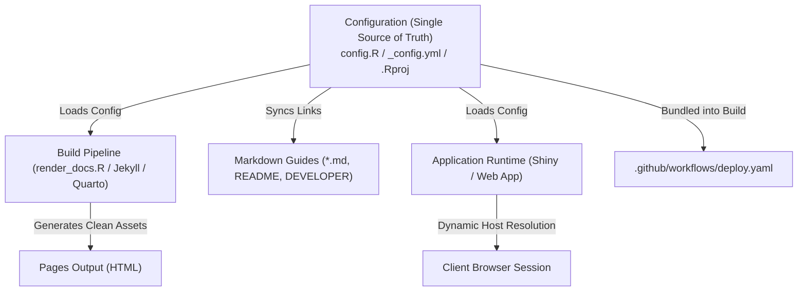
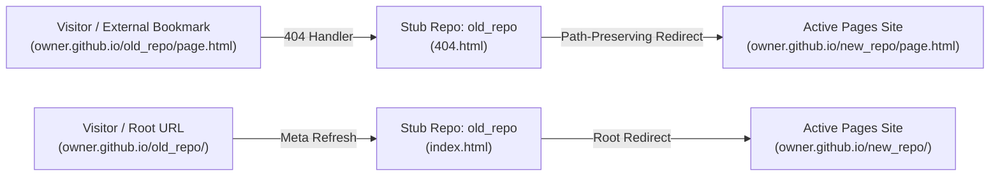

# Prepare to Move or Rename a GitHub Repo

A comprehensive guide and architectural pattern for preparing, centralizing, and executing repository transfers between GitHub accounts or renaming repositories without broken links, deployment failures, or stale documentation.

---

## 1. Overview & Scenarios

Moving a repository involves two primary scenarios—and often a combination of both:

1. **Repository Renaming** (e.g., `byandell/Documentation` $\to$ `byandell/DocumentTools`): Changing the repository name while retaining the same owner account.
2. **Ownership Transfer** (e.g., `byandell/MafADiscovery` $\to$ `lab-org/MafADiscovery`): Transferring the repository to a new personal account or organization.
3. **Combined Move & Rename** (e.g., `byandell/Documentation` $\to$ `lab-org/DocumentTools`).

### Challenges & Failure Modes

| Challenge Area | Symptoms if Unprepared | Root Cause |
| :--- | :--- | :--- |
| **GitHub Pages Divergence** | Broken documentation or 404 errors for external visitors. | While GitHub sets up temporary HTTP redirects for repository code (`github.com/old/repo` $\to$ `github.com/new/repo`), **GitHub Pages URLs (`old.github.io/old_repo`) do not redirect** once pages are rebuilt or namespaces change. |
| **Markdown Source Link Fragility** | Links to guides fail when readers browse source files directly on GitHub. | Relative links to rendered HTML pages (e.g., `[User Guide](user_guide.html)`) produce 404 errors in GitHub's raw markdown viewer because GitHub only serves source files, not the compiled web assets. |
| **Compiled Website Relative Pathing** | Deployed documentation links break when previewed locally or offline. | If Markdown source files use hardcoded absolute URLs (`https://old.github.io/repo/docs/...`), local preview servers and static builds cannot resolve internal pages relatively. |
| **Project & IDE Containers** | RStudio / IDE configurations break or refer to obsolete projects. | Project descriptor files (such as `Documentation.Rproj`) fail to track the new repository naming. |
| **Application Runtime Navigation** | Help/Guide buttons in Shiny/web apps point to obsolete URLs. | Hardcoded URLs in the application UI fail to track the new hosting namespace. |
| **CI/CD Pipeline Lock-In** | Automated deployments fail or publish to incorrect locations. | Workflows with hardcoded organization or repository names fail upon transfer or rename. |

To solve these challenges sustainably, this pattern decouples repository identity into a **single source of truth** combined with automated link synchronization and runtime dynamic resolution.

---

## 2. Core Architecture: The Single Source of Truth

Rather than scattering repository URLs, account names, and project identifiers across dozens of files, centralize repository identity attributes into the appropriate root configuration files:



### Reference Configurations

#### A. R / Shiny Application Repositories (`config.R`)

```r
# config.R
# Central repository configuration — Single Source of Truth
# Update `owner` or `repo` when transferring or renaming the repository.

GITHUB_CONFIG <- list(
  owner  = "byandell",          # GitHub user or organization
  repo   = "DocumentTools",     # Repository name
  branch = "main"               # Default production branch
)

# Derived URLs
GITHUB_CONFIG$pages_url <- sprintf("https://%s.github.io/%s", GITHUB_CONFIG$owner, GITHUB_CONFIG$repo)
GITHUB_CONFIG$repo_url  <- sprintf("https://github.com/%s/%s", GITHUB_CONFIG$owner, GITHUB_CONFIG$repo)
GITHUB_CONFIG$docs_url  <- sprintf("%s/docs", GITHUB_CONFIG$pages_url)
GITHUB_CONFIG$blob_url  <- sprintf("%s/blob/%s", GITHUB_CONFIG$repo_url, GITHUB_CONFIG$branch)
```

#### B. Jekyll / Documentation Repositories (`_config.yml`)

```yaml
# _config.yml
title: "Document Tools"
description: "Document Tools"
url: "https://byandell.github.io"
baseurl: "/DocumentTools"

nav_external_links:
  - title: DocumentTools Source
    url: https://github.com/byandell/DocumentTools
    opens_in_new_tab: true
```

#### C. RStudio Project Files

When renaming an R-based repository, rename `<OldRepo>.Rproj` to `<NewRepo>.Rproj` so RStudio sessions track the new project container.

---

## 3. Dual-Link Strategy: Source Viability vs. Rendered Portability

Documentation must satisfy two conflicting requirements:

1. **Source Readers on GitHub**: Users reading raw Markdown files on `github.com` need absolute URLs (`https://<owner>.github.io/<repo>/docs/user_guide.html`) so clicking a link opens the live compiled documentation.
2. **Web Visitors & Local Testers**: The compiled HTML site on GitHub Pages or local preview must use clean relative links (`user_guide.html`) so links work offline, in local HTTP servers, and under custom domains.

### The Solution: Dynamic Relativization at Build Time

Maintain fully qualified absolute URLs in Markdown source files, but configure the build script (`render_docs.R`) to strip the repository prefix when generating HTML:

```r
# In render_docs.R:
# Automatically relativize internal documentation URLs during HTML rendering
docs_pattern <- sprintf("https://%s\\.github\\.io/%s/docs/", GITHUB_CONFIG$owner, GITHUB_CONFIG$repo)
md_content <- gsub(docs_pattern, "", md_content)
# Catch generic fallback pattern in case of legacy links:
md_content <- gsub("https://[a-zA-Z0-9_-]+\\.github\\.io/[a-zA-Z0-9_-]+/docs/", "", md_content)
```

Result:
* On GitHub source view: `[User Guide](https://byandell.github.io/DocumentTools/docs/user_guide.html)` $\to$ **Clickable, live documentation**.
* On rendered web page: `<a href="user_guide.html">User Guide</a>` $\to$ **Fast, relative, portable link**.

---

## 4. Automated Markdown Link Synchronization

When either `owner` or `repo` changes, an automated synchronization routine scans all Markdown and Quarto files and rewrites obsolete GitHub and GitHub Pages URLs.

### R Implementation

```r
#' Synchronize GitHub repository links across workspace documentation
#'
#' @param old_repo Previous repository name (e.g. "Documentation")
#' @param new_repo New repository name (e.g. "DocumentTools")
#' @param old_owner Previous owner (e.g. "byandell")
#' @param new_owner New owner (default matches old_owner)
#' @param dry_run If TRUE, preview updates without modifying files
sync_markdown_links <- function(old_repo, new_repo,
                                old_owner = "byandell", new_owner = old_owner,
                                dry_run = FALSE) {
  md_files <- list.files(
    pattern = "\\.(md|qmd)$",
    recursive = TRUE,
    full.names = TRUE
  )
  # Exclude build, cache, and git directories
  md_files <- md_files[!grepl("^\\./(\\.git|site_libs|\\.quarto|_site)/", md_files)]
  
  updated_count <- 0
  
  old_pages <- sprintf("https://%s\\.github\\.io/%s", old_owner, old_repo)
  new_pages <- sprintf("https://%s.github.io/%s", new_owner, new_repo)
  
  old_repo_url <- sprintf("https://github\\.com/%s/%s", old_owner, old_repo)
  new_repo_url <- sprintf("https://github.com/%s/%s", new_owner, new_repo)
  
  for (f in md_files) {
    content <- readLines(f, encoding = "UTF-8", warn = FALSE)
    orig_text <- paste(content, collapse = "\n")
    new_text <- orig_text
    
    # 1. Update GitHub Pages URLs
    new_text <- gsub(old_pages, new_pages, new_text)
    
    # 2. Update GitHub repository URLs
    new_text <- gsub(old_repo_url, new_repo_url, new_text)
    
    # 3. Update Markdown repository badges/slugs: [old_owner/old_repo]
    old_slug <- sprintf("\\[%s/%s\\]", old_owner, old_repo)
    new_slug <- sprintf("[%s/%s]", new_owner, new_repo)
    new_text <- gsub(old_slug, new_slug, new_text)
    
    if (new_text != orig_text) {
      if (!dry_run) {
        writeLines(strsplit(new_text, "\n")[[1]], f, useBytes = TRUE)
      }
      updated_count <- updated_count + 1
      cat(sprintf("  [%s] %s\n", if (dry_run) "Would update" else "Updated", f))
    }
  }
  
  invisible(updated_count)
}
```

### Python Implementation

A standalone Python script can be run across any repository without R dependencies:

```python
#!/usr/bin/env python3
import os, re, sys

def sync_links(old_repo, new_repo, old_owner="byandell", new_owner=None, dry_run=False):
    if not new_owner:
        new_owner = old_owner

    patterns = [
        (re.compile(rf"https://{old_owner}\.github\.io/{old_repo}"), f"https://{new_owner}.github.io/{new_repo}"),
        (re.compile(rf"https://github\.com/{old_owner}/{old_repo}"), f"https://github.com/{new_owner}/{new_repo}"),
        (re.compile(rf"\[{old_owner}/{old_repo}\]"), f"[{new_owner}/{new_repo}]"),
        (re.compile(rf"localhost:4000/{old_repo}/"), f"localhost:4000/{new_repo}/")
    ]

    updated = 0
    for root, dirs, files in os.walk("."):
        if any(p in root for p in [".git", "site_libs", ".quarto", "_site"]):
            continue
        for f in files:
            if f.endswith((".md", ".qmd", ".yml", ".yaml", ".R", ".py")):
                path = os.path.join(root, f)
                with open(path, "r", encoding="utf-8") as fh:
                    orig = fh.read()
                new_text = orig
                for pattern, replacement in patterns:
                    new_text = pattern.sub(replacement, new_text)
                if new_text != orig:
                    if not dry_run:
                        with open(path, "w", encoding="utf-8") as fh:
                            fh.write(new_text)
                    print(f"[{'WOULD UPDATE' if dry_run else 'UPDATED'}] {path}")
                    updated += 1
    return updated
```

---

## 5. Web Application Runtime Resilience

Web applications (such as Shiny or Shinylive apps) should avoid hardcoding the deployment URL at runtime.

### Dynamic Client-Side Path Resolution

In `SHINY_APP/app.R`, client-side JavaScript dynamically inspects `window.location` to determine the active host and base path:

```javascript
function resolveDocsUrl(subpath) {
  subpath = subpath || 'user_guide.html';
  if (window.location.pathname.indexOf('/app_') !== -1 || window.location.hostname.includes('github.io')) {
    var base = window.location.pathname.replace(/\/app_[^\/]+.*$/, '').replace(/\/index\.html$/, '').replace(/\/$/, '');
    return window.location.origin + base + '/docs/' + subpath;
  }
  return 'docs/' + subpath;
}
```

### Preserving Parent Window Control (`rel = "opener"`)

When linking from an interactive application to external documentation, use `rel = "opener"` instead of `rel = "noopener noreferrer"`:

```r
tags$a(
  id = "btn-guide-link",
  href = sprintf("%s/user_guide.html", GITHUB_CONFIG$docs_url),
  target = "_blank",
  rel = "opener",
  onclick = "this.href = resolveDocsUrl('user_guide.html');",
  class = "btn btn-sm btn-help",
  "📖 Guide ↗"
)
```

This allows the documentation page's "Open App" button to return directly to the existing session tab and close the guides tab:

```javascript
function handleOpenApp(e) {
  if (window.opener && !window.opener.closed) {
    e.preventDefault();
    try { window.opener.focus(); } catch (err) {}
    try { window.close(); } catch (err) {}
    return false;
  }
  return true;
}
```

---

## 6. Owner- & Repo-Agnostic CI/CD Workflows

Ensure GitHub Actions deployment workflows contain zero hardcoded user or repository names.

In `.github/workflows/deploy-shinylive.yaml` or `.github/workflows/pages.yaml`:

* **Use Built-in Action Variables**: Rely on default repository tokens (`secrets.GITHUB_TOKEN`) and built-in Pages outputs:

  ```yaml
  url: ${{ steps.deployment.outputs.page_url }}
  ```

* **Bundle Central Configuration**: Ensure `config.R` is copied into the application export directory prior to packaging so the deployed bundle remains self-contained:

  ```bash
  cp config.R SHINY_APP/ 2>/dev/null || true
  ```

* **Bypass Jekyll Processing**: Always include an empty `.nojekyll` file in the published site root to ensure files starting with underscores or custom directory structures are not ignored by GitHub Pages.

---

## 7. Preserving Legacy URLs: The Redirect Stub Repository Pattern

While GitHub automatically issues HTTP 301 redirects for git operations and web code views (`github.com/owner/old_repo` $\to$ `github.com/owner/new_repo`), **GitHub Pages does not forward traffic from obsolete URLs**. As soon as the repository is renamed, visiting `https://<owner>.github.io/<old_repo>/` immediately throws an HTTP 404 error, breaking external bookmarks, paper citations, and search engine index links.

To solve this sustainably, deploy a lightweight **Redirect Stub Repository** at the old repository name.



### Reference Implementation

In a new public repository named after the old repository (`<old_repo>`), place two HTML files in the root:

#### 1. Root Forwarder (`index.html`)

Redirects direct visitors to the new repository landing page:

```html
<!DOCTYPE html>
<html lang="en">
<head>
  <meta charset="utf-8">
  <title>Redirecting to new site...</title>
  <meta http-equiv="refresh" content="0; url=https://byandell.github.io/DocumentTools/">
  <link rel="canonical" href="https://byandell.github.io/DocumentTools/">
  <script>
    window.location.replace("https://byandell.github.io/DocumentTools/" + window.location.search + window.location.hash);
  </script>
</head>
<body>
  <p>This documentation has moved to <a href="https://byandell.github.io/DocumentTools/">DocumentTools</a>.</p>
</body>
</html>
```

#### 2. Deep-Link Forwarder (`404.html`)

GitHub Pages serves `404.html` for any unrecognized sub-path. This script captures the requested sub-path, strips the obsolete repository prefix, and transparently routes the reader to the exact corresponding article, presentation, or asset on the new site:

```html
<!DOCTYPE html>
<html lang="en">
<head>
  <meta charset="utf-8">
  <title>Redirecting to new site...</title>
  <script>
    const newBase = "https://byandell.github.io/DocumentTools";
    const oldBase = "/Documentation";
    let path = window.location.pathname;
    if (path.startsWith(oldBase)) {
      path = path.slice(oldBase.length);
    }
    window.location.replace(newBase + path + window.location.search + window.location.hash);
  </script>
</head>
<body>
  <p>Redirecting to <a href="https://byandell.github.io/DocumentTools/">DocumentTools</a>...</p>
</body>
</html>
```

#### 3. Activation

Under the stub repository's **Settings** $\to$ **Pages**:
- **Source**: Select **Deploy from a branch**.
- **Branch**: Select `main` (or `master`) and `/ (root)`.
- Click **Save**.

The redirect becomes active globally within 1–2 minutes.

---

## 8. Migration Checklist: Step-by-Step Execution

### Scenario A: Repository Renaming (`owner/old_repo` $\to$ `owner/new_repo`)

#### Phase 1: Pre-Rename Local Configuration
1. **Update Root Configuration**:
   - For Jekyll sites: Update `_config.yml` (`baseurl: "/<new_repo>"`, `title`, and external links).
   - For R/Shiny sites: Update `config.R` (`repo = "<new_repo>"`).
2. **Rename Project Container**:
   - Rename `<old_repo>.Rproj` to `<new_repo>.Rproj`.
3. **Synchronize Documentation Links**:
   - Run `sync_markdown_links()` or python sync utility across the repository.
   - Update governance files (`AGENTS.md`, `DEVELOPER.md`, `README.md`).
4. **Recompile Documentation & Verify**:
   - Recompile slides or site assets (`quarto render`).
   - Run link health checks (`python3 scripts/check_links.py`).
5. **Commit & Push Prepared Changes**:
   - Push all updated files to the current remote repository on GitHub before renaming.

#### Phase 2: Execute GitHub Rename (Web UI)
1. On GitHub, navigate to **Settings** $\to$ **General**.
2. Under **Repository name**, enter the new repository name and click **Rename**.
3. GitHub automatically updates GitHub Pages publishing to `https://<owner>.github.io/<new_repo>/`.

#### Phase 3: Post-Rename Local Alignment
1. **Update Local Git Remote**:
   ```bash
   git remote set-url origin https://github.com/<owner>/<new_repo>.git
   git remote -v
   ```
2. **(Optional) Rename Local Clone Directory**:
   ```bash
   cd ..
   mv <old_repo> <new_repo>
   cd <new_repo>
   ```

#### Phase 4: Deploy Legacy Redirect Stub Repository (Prevent 404s)
1. Create a new public repository on GitHub named `<old_repo>`.
2. Commit `index.html` and `404.html` as detailed in [Section 7](#7-preserving-legacy-urls-the-redirect-stub-repository-pattern).
3. Enable GitHub Pages on the stub repository (**Settings** $\to$ **Pages** $\to$ Deploy from branch `main` / `root`).
4. Verify by visiting `https://<owner>.github.io/<old_repo>/` to confirm instant redirection to `https://<owner>.github.io/<new_repo>/`.

---

### Scenario B: Ownership Transfer (`old_owner/repo` $\to$ `new_owner/repo`)

1. **Pre-Transfer Configuration**: Update `config.R` (`owner = "new-owner"`) and run `sync_markdown_links()`. Commit and push to `origin/main`.
2. **GitHub Transfer (Web UI)**: Navigate to **Settings** $\to$ **General** $\to$ **Danger Zone** $\to$ **Transfer ownership**. Confirm the transfer.
3. **Post-Transfer Verification**:
   - Verify GitHub Pages settings (**Settings** $\to$ **Pages**).
   - Trigger deployment workflow under **Actions** tab.
   - Update local git remote: `git remote set-url origin https://github.com/<new_owner>/<repo>.git`.
