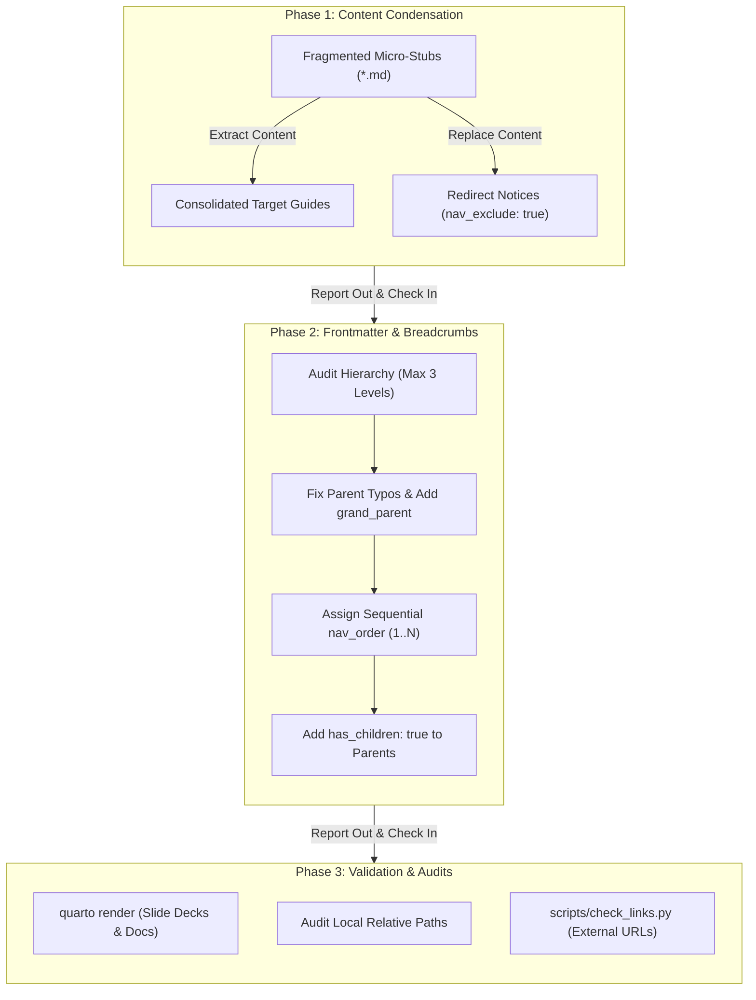

# Refactor Documentation & Navigation

A comprehensive guide, prompt blueprint, and architectural pattern for condensing fragmented markdown documentation, standardizing frontmatter hierarchies, and improving sidebar navigation across large documentation repositories without breaking existing links.

---

## 1. Challenge & Context

As documentation repositories evolve over years of research, instruction, and project development, they tend to accumulate several architectural anti-patterns:

1. **Content Fragmentation (Micro-Stubs)**: Short 10–30 line notes and stubs scattered across deeply nested directories, making reading disjointed.
2. **Navigation Depth Limits**: Static site engines like [Just-the-Docs](https://just-the-docs.com/) support a maximum 3-level navigation hierarchy (`Site` $\to$ `Section / Parent` $\to$ `Page / Grandchild`). Deeper 4th-level nesting breaks breadcrumbs and causes pages to disappear or render unpredictably in the sidebar.
3. **Broken Link Fragility**: Simply deleting obsolete stubs causes 404 errors for external bookmarks, search engines, and cross-document markdown links.
4. **Frontmatter Inconsistencies**: Typos in `parent:` names, missing `grand_parent:` declarations on level-3 pages, missing `has_children: true` flags, and disordered or duplicate `nav_order` keys cause navigation sidebar chaos.

To resolve these challenges without disruption, we apply a **phased consolidation pattern** that preserves all unique material, maintains zero-downtime redirect notices, standardizes 3-level breadcrumbs, and empirically validates the site build.

---

## 2. The Refactoring Prompt

Use this prompt to guide an AI agent through a safe, phased documentation refactoring:

```markdown
Refactor Markdowns: This repo has grown substantially. Keeping the same structure we have in this repo (folders and files with breadcrumbs via `nav_order`), create a plan to condense markdown documents and improve navigation.

Proceed one phase at a time with report out and check in:
- Phase 1: Consolidate micro-stubs into substantial target documents. Preserve all unique links, commentary, and code. Replace old stub files with 3-line backward-compatible redirection notices setting `nav_exclude: true`.
- Phase 2: Standardize frontmatter, breadcrumbs, and sequential `nav_order`. Enforce a strict 3-level Just-the-Docs hierarchy (Site -> Parent -> Child), resolve parent typos, add missing `grand_parent` fields, and ensure `has_children: true` is on all parents.
- Phase 3: Link audit and build verification. Run internal relative link checks, verify `quarto render`, and run `python3 scripts/check_links.py` to produce an updated external link health report.
```

---

## 3. Phased Implementation Architecture



---

## 4. Phase-by-Phase Instructions

### Phase 1: Consolidate Stubs into Canonical Guides

1. **Map Micro-Stubs to Topics**: Group fragmented files in each section by core topic or verb (e.g. merging individual tools like Docker, Linux, and Software into a single `dev_environment.md` guide).
2. **Preserve Code & Context**: Combine explanatory narrative, setup commands, and references under structured `##` and `###` headers.
3. **Zero-Downtime Redirection Notices**:
   Never delete the original stub file from disk. Instead, replace its contents with a clean markdown redirect notice:

   ```yaml
   ---
   title: "Legacy Topic Name"
   nav_exclude: true
   ---

   # Legacy Topic Name

   > **Note**: This guide has been consolidated into [Canonical Target Title](canonical_target.md). Please update your bookmarks.
   ```

   - `nav_exclude: true` hides the legacy stub from the navigation sidebar while keeping it accessible to incoming links.

### Phase 2: Standardize Frontmatter & Breadcrumbs

1. **Strict 3-Level Depth Constraint**:
   - **Level 1 (Top Level)**: Home page (`README.md` with `permalink: /`, `nav_order: 0`).
   - **Level 2 (Section Parent)**: Subfolder `README.md` or major hub page:
     ```yaml
     ---
     title: "R Language"
     parent: "Document Tools"
     nav_order: 1
     has_children: true
     permalink: /R/
     ---
     ```
   - **Level 3 (Child / Grandchild)**: Individual guide:
     ```yaml
     ---
     title: "Overview of R Material"
     parent: "R Language"
     nav_order: 1
     has_children: true
     ---
     ```
   - If a Level-3 page itself has children (e.g. `R/learn/syllabus.md`), the grandchild must specify both `parent` and `grand_parent`:
     ```yaml
     ---
     title: "R Syllabus"
     parent: "Overview of R Material"
     grand_parent: "R Language"
     nav_order: 1
     ---
     ```
2. **Flatten 4th-Level Subdirectories**:
   If directories are nested 4 levels deep (e.g., `R/visualize/network/`), flatten the active files up to the 3rd level (e.g., `R/visualize/network_data.md`), leaving redirect notices in the subfolder.
3. **Enforce Contiguous `nav_order`**:
   Assign contiguous 1-based sequential integers (`1, 2, 3, ...`) across all active siblings under each parent. Avoid duplicate order numbers or large arbitrary gaps.

### Phase 3: Automated Link & Build Verification

1. **Quarto Build Verification**:
   Render all presentation slide decks and compiled pages to ensure no Pandoc or YAML frontmatter parse errors occurred:
   ```bash
   quarto render quarto/
   ```
2. **Internal Relative Link Audit**:
   Verify that all local intra-repository markdown links `[Title](path.md)` resolve to active files on disk. Check for:
   - Obsolete links pointing to deleted or renamed files.
   - Missing `../` prefixes when files move up or across directories.
   - Unprefixed URLs (e.g. `[R](cran.r-project.org)` missing `https://`).
3. **External Link Verification**:
   Run the repository link checker to scan all `.md`, `.qmd`, and `.Rmd` files for dead external links:
   ```bash
   python3 scripts/check_links.py -t 16 --timeout 5
   ```

---

## 5. Case Study: The DocumentTools Repository Refactoring

In October 2026, the `byandell/DocumentTools` repository underwent a comprehensive restructuring using this exact pattern.

### Results & Consolidations Table

| Target Section | Legacy Source Files Merged | New Consolidated Canonical Target | Status |
| :--- | :--- | :--- | :--- |
| **`prompts/`** | `broken_links.md` | [check_links.md](check_links.md) | Redirect stub created |
| | `devel_guide_qtl2shiny.md` | [devel_guide.md](devel_guide.md) | Folded in as Case Study |
| | `global_agents_template.md` | [agents_craft_templates.md](agents_craft_templates.md) | Combined CRAFT instructions |
| | `powerpoint.md`, `quarto.md` | [presentation_prompts.md](presentation_prompts.md) | Unified presentation guide |
| **`shiny/`** | `shiny_module.md` | [shiny/geyser.md](../shiny/geyser.md) | Module pattern integrated |
| | `qtlApp.md` | [shiny/qtl2shiny.md](../shiny/qtl2shiny.md) | Unified qtl2 shiny app guide |
| **`github/`** | `shinylive.md` | [github/embed.md](../github/embed.md) | Shinylive embedding merged |
| | `quartolive.md` (parent mismatch) | [github/quartolive.md](../github/quartolive.md) | Linked to `Publish GitHub Pages` |
| **`R/learn/`** | `background.md`, `Bates.md` | [R/learn/history.md](../R/learn/history.md) | Unified R historical notes |
| **`R/curate/`** | `string.md` | [R/curate/regex.md](../R/curate/regex.md) | Consolidated regex & strings |
| **`R/profile/`**| `simulate.md` | [R/profile/profile.md](../R/profile/profile.md) | Profiling & simulation guide |
| **`R/organize/`**| `Rmarkdown.md` | [R/organize/RmarkdownExample.md](../R/organize/RmarkdownExample.md) | Merged Rmd tips & fixed parent |
| **`R/analyze/`**| `sysgen.md` | [R/analyze/README.md](../R/analyze/README.md) | Overview unified |
| **`R/visualize/`**| `graphics.md` | [R/visualize/ggplot2.md](../R/visualize/ggplot2.md) | Base graphics vs ggplot2 guide |
| | `network/network*.md` (4 files) | `R/visualize/network_*.md` (3 files) | Flattened 4th-level nesting |
| **`R/connect/`**| 14 micro-stubs (docker, linux, reproducible, writing, latex, software, scaling, beyondR, plan, profSkills, programs, blended, nontrad) | Consolidated into 4 cohesive guides:<br/>1. [dev_environment.md](../R/connect/dev_environment.md)<br/>2. [reproducible_publishing.md](../R/connect/reproducible_publishing.md)<br/>3. [scaling_teams.md](../R/connect/scaling_teams.md)<br/>4. [academic_programs.md](../R/connect/academic_programs.md) | Redirect stubs created for all 14 legacy paths |

### Quantitative Impact
- **Files Condensed**: 28 micro-stubs merged into 8 cohesive guides.
- **Lines Removed**: Net reduction of ~2,700 redundant boilerplate lines.
- **Broken Redirects**: 0 (100% of legacy paths preserved via `nav_exclude: true`).
- **Navigation Errors**: 0 missing parents, 0 missing grandparents, 0 duplicate `nav_order` values.
- **Build Verification**: Clean Quarto render across all 8 slide decks.
